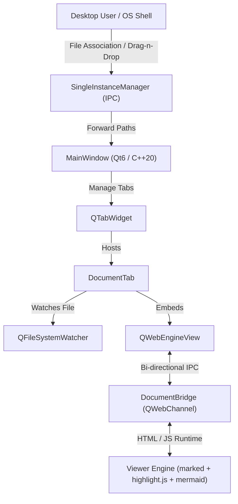

# MarkdownReader

<p align="center">
  
</p>

<p align="center">
  <strong>A modern, high-performance, 100% offline Markdown & Mermaid diagram viewer built with C++20 and Qt 6.</strong>
</p>

<p align="center">
  <a href="https://github.com"></a>
  <a href="https://en.cppreference.com/w/cpp/20"></a>
  <a href="https://www.qt.io/"></a>
  <a href="https://opensource.org/licenses/MIT"></a>
  
  
</p>

<p align="center">
  <a href="#features">Features</a> •
  <a href="#releases--downloads">Downloads</a> •
  <a href="#architecture">Architecture</a> •
  <a href="#building-from-source">Building from Source</a> •
  <a href="#file-association--single-instance">OS Integration</a> •
  <a href="README_fa.md">راهنمای فارسی</a>
</p>

---

## Overview

**MarkdownReader** is a standalone desktop application engineered in C++20 and Qt 6.8 designed to render Markdown documents and complex Mermaid diagrams with fluid performance and zero external internet dependencies.

Equipped with an embedded Chromium engine via Qt WebEngine, it delivers pixel-perfect typography, rich syntax highlighting across 190+ languages, an interactive SVG diagram canvas with up to 30x zoom and pan, multi-tab file management, and instant hot-reloading when source files are edited externally.

---

## Features

- ⚡ **100% Self-Contained & Offline:** All parsers, styling engines, and diagram libraries (`marked`, `highlight.js`, `mermaid.js`, `qwebchannel`) are embedded directly into the binary through Qt resources (`resources.qrc`). No internet telemetry, zero external CDN requests.
- 📊 **Interactive Mermaid Canvas:**
  - Full support for Flowcharts, Sequence Diagrams, State Machines, Class Diagrams, Git Graphs, Entity-Relationship diagrams, and Mindmaps.
  - **Auto-Fit Engine:** Automatically computes diagram bounding boxes and viewBox dimensions so diagrams are displayed in full upon initial load without clipped edges.
  - **Smooth Zoom & Pan:** Native mouse-wheel scaling, click-and-drag viewport panning, and a dedicated modal inspection viewer with up to 30x magnification.
- 📑 **Multi-Tab Workspace:** Open multiple `.md` files concurrently across independent tabs. Each tab features isolated scroll state, zoom level, and file monitoring.
- 🔄 **Live Hot-Reload:** Powered by `QFileSystemWatcher`. Edits made in external editors (VS Code, Neovim, Obsidian, Notepad) refresh instantaneously without losing your reading position or viewport zoom.
- 🎨 **Adaptive Dark & Light Themes:**
  - Real-time synchronization with Windows and Linux desktop color schemes via `QStyleHints`.
  - Manual theme toggle switch that re-renders both the Qt application interface and the Markdown/Mermaid document simultaneously.
- 🪟 **Deep Desktop Integration:**
  - **Single-Instance IPC:** Opening `.md` files from File Explorer sends paths via a local IPC socket (`QLocalServer`/`QLocalSocket`) to the active instance, creating new tabs and focusing the window instead of spawning redundant background processes.
  - **Native File Association:** One-click integration with Windows Explorer to set MarkdownReader as the default handler for `.md` and `.markdown` files.
  - **Drag and Drop:** Drag any `.md` file from your desktop or file manager directly into the application.
  - **High-DPI Native Icons:** Multi-resolution icons embedded directly into executable PE headers (`app.rc`).

---

## Releases & Downloads

Pre-built standalone releases for **v1.0.0** are available under the [GitHub Releases](https://github.com) page:

| Platform | Architecture | Package Format | Details |
| :--- | :--- | :--- | :--- |
| **Windows** | x86_64 / x64 | `.zip` archive | Fully self-contained (`windeployqt` deployed, portable, no installation required). |
| **Linux** | x86_64 | `.tar.gz` archive | Native ELF binary compatible with modern desktop distributions (Ubuntu 22.04+, Debian 12+, Fedora, Arch). |

---

## Architecture

The project pairs a C++ Qt core with an embedded WebEngine view through a bidirectional `QWebChannel`:



### Source Tree Structure

```text
MarkdownReader/
├── CMakeLists.txt              # Cross-platform CMake 3.25+ build definition
├── CMakePresets.json           # Presets for Ninja and MSVC 2022
├── main.cpp                    # Application entry point, CLI parser, and IPC guard
├── resources.qrc               # Embedded offline assets (HTML, CSS, JS, Fonts)
├── sample.md                   # Comprehensive Markdown and Mermaid showcase
├── .github/
│   └── workflows/
│       └── release.yml         # Automated GitHub Actions multi-platform release CI/CD
├── resources/
│   ├── app.rc                  # Windows PE resource script with version & icon
│   ├── app_icon.ico            # Multi-size Windows application icon
│   ├── app_icon.png            # PNG logo asset
│   ├── viewer.html             # Embedded viewer DOM structure
│   ├── viewer.css              # Typography, dark/light theme definitions, zoom canvas
│   ├── viewer.js               # Marked parser, Mermaid auto-fit, and pan-zoom controller
│   ├── marked.min.js           # Offline CommonMark / GFM parsing engine
│   ├── mermaid.min.js          # Offline vector diagram rendering engine
│   ├── highlight.min.js        # Offline code syntax highlighting engine
│   ├── qwebchannel.js          # Qt C++ to JavaScript communication channel
│   ├── github.min.css          # Syntax highlighting dark theme
│   └── github-light.min.css    # Syntax highlighting light theme
└── src/
    ├── MainWindow.h/.cpp       # Main window, menus, tab control, drag-drop filter
    ├── DocumentTab.h/.cpp      # Individual document container with QWebEngineView & watcher
    ├── DocumentBridge.h        # QWebChannel communication bridge
    ├── SingleInstance.h/.cpp   # QLocalServer / QLocalSocket IPC process controller
    └── WindowsAssociation.h/.cpp # Windows registry integration (.md file association)
```

---

## Building from Source

### Prerequisites

- **C++ Compiler:** MSVC 2022 (v143) on Windows or GCC 11+ / Clang 14+ on Linux with C++20 support.
- **CMake:** Version 3.25 or newer.
- **Build System:** Ninja (recommended) or Make.
- **Qt 6 Framework:** Qt 6.8+ with the following modules:
  - `Core`, `Gui`, `Widgets`, `WebEngineWidgets`, `WebChannel`, `Network`

### Windows (MSVC 2022 + Ninja)

1. Open **x64 Native Tools Command Prompt for VS 2022**.
2. Configure and build:
   ```cmd
   cmake -B build -G "Ninja" -DCMAKE_BUILD_TYPE=Release -DCMAKE_PREFIX_PATH="C:\Qt\6.8.0\msvc2022_64"
   cmake --build build --config Release
   ```
3. Deploy runtime dependencies for offline standalone use:
   ```cmd
   windeployqt --no-translations --compiler-runtime build\MarkdownReader.exe
   ```

### Linux (Ubuntu / Debian / Fedora)

1. Install dependencies:
   ```bash
   # Debian / Ubuntu / Kali
   sudo apt-get update
   sudo apt-get install -y build-essential cmake ninja-build \
       qt6-base-dev qt6-webengine-dev qt6-webchannel-dev libgl1-mesa-dev

   # Fedora
   sudo dnf install -y gcc-c++ cmake ninja-build \
       qt6-qtbase-devel qt6-qtwebengine-devel qt6-qtwebchannel-devel
   ```
2. Configure and build:
   ```bash
   cmake -B build-linux -G Ninja -DCMAKE_BUILD_TYPE=Release
   cmake --build build-linux
   ```
3. Run:
   ```bash
   ./build-linux/MarkdownReader sample.md
   ```

---

## OS Integration

### Windows Default Handler
To associate `.md` and `.markdown` files with MarkdownReader:
1. Launch MarkdownReader.
2. In the menu bar, open **Settings** → **Set as Default .md Viewer**.
3. Now, double-clicking any Markdown file in Windows File Explorer will open directly inside MarkdownReader.

### Single-Instance Behavior
When MarkdownReader is already running, launching another file from terminal or Explorer seamlessly transfers the path to the running instance over local named pipes (`QLocalSocket`), opening a new tab and focusing the window without running multiple heavy browser processes.

---

## License

This project is licensed under the [MIT License](LICENSE).
Libraries bundled under `resources/` (`marked`, `mermaid`, `highlight.js`) are licensed under their respective open-source licenses (MIT/BSD).
