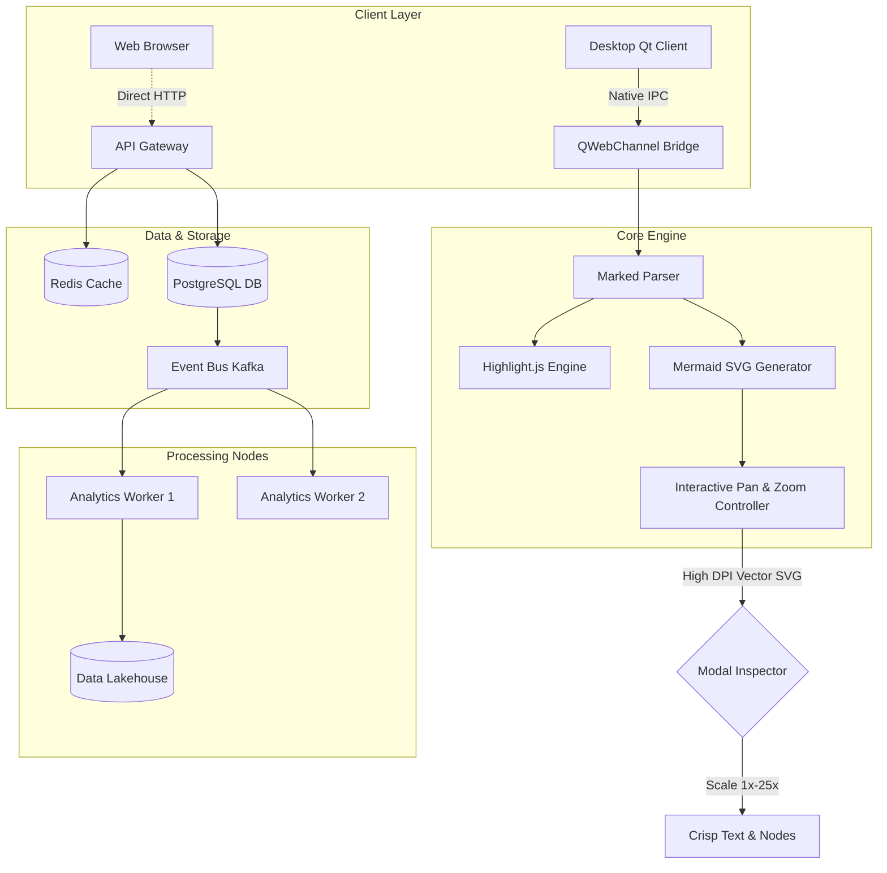
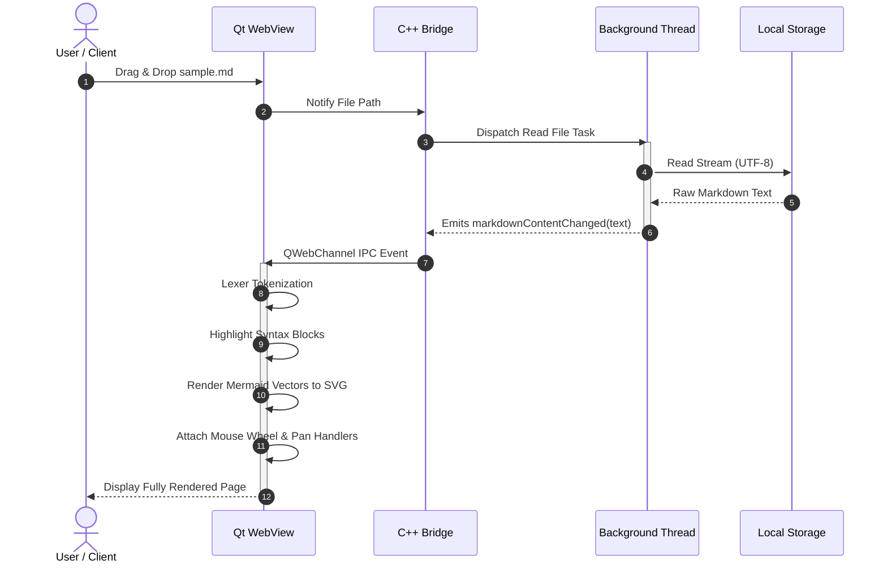
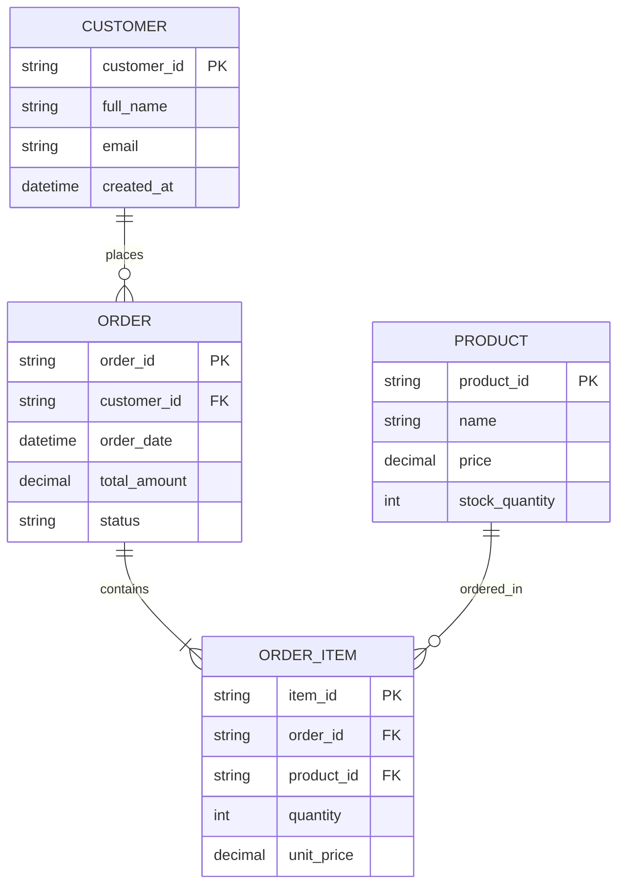

# Markdown Reader & High-DPI Mermaid Engine

Welcome to **Markdown Reader**, an offline desktop viewer built with **C++** and **Qt 6.8 WebEngine**.

---

## 1. Syntax Highlighting Showcase

### C++20 / C++23 Example
```cpp
#include <iostream>
#include <vector>
#include <ranges>
#include <string_view>

auto filter_even_squares(const std::vector<int>& numbers) {
    return numbers 
        | std::views::filter([](int n) { return n % 2 == 0; })
        | std::views::transform([](int n) { return n * n; });
}

int main() {
    std::vector<int> data = {1, 2, 3, 4, 5, 6, 7, 8};
    for (int v : filter_even_squares(data)) {
        std::cout << "Value: " << v << '\n';
    }
    return 0;
}
```

### Python Asynchronous Pipeline
```python
import asyncio
from typing import AsyncGenerator

async def data_stream() -> AsyncGenerator[dict, None]:
    for i in range(5):
        await asyncio.sleep(0.1)
        yield {"id": i, "payload": f"Telemetry #{i}"}

async def main():
    async for item in data_stream():
        print(f"Received: {item['payload']}")

if __name__ == "__main__":
    asyncio.run(main())
```

### SQL Analytics Query
```sql
WITH MonthlyMetrics AS (
    SELECT 
        DATE_TRUNC('month', order_date) AS order_month,
        user_id,
        COUNT(order_id) AS total_orders,
        SUM(amount) AS total_revenue
    FROM public.orders
    WHERE status = 'COMPLETED'
    GROUP BY 1, 2
)
SELECT 
    order_month,
    COUNT(DISTINCT user_id) AS active_customers,
    ROUND(AVG(total_revenue), 2) AS arpu
FROM MonthlyMetrics
GROUP BY order_month
ORDER BY order_month DESC;
```

---

## 2. Interactive Zoomable Mermaid Diagrams

> [!TIP]
> **Zoom & Pan Controls:**
> - **Mouse Wheel**: Zoom in and out directly inside the diagram area.
> - **Click & Drag**: Pan smoothly across the 2D canvas.
> - **Fullscreen Zoom Button**: Expands the diagram into an inspection modal for ultra-dense diagrams!

### Complex System Architecture Flowchart



### Detailed Microservices Sequence Diagram



### Database Entity-Relationship Diagram



---

## 3. Data Tables & Task Lists

| Feature | Supported | Rendering Engine | Offline Capable |
| :--- | :---: | :--- | :---: |
| GitHub Flavored Markdown | ✅ Yes | Marked.js | ✅ 100% |
| Syntax Highlighting | ✅ Yes | Highlight.js (190+ languages) | ✅ 100% |
| Mermaid Diagrams | ✅ Yes | Mermaid.js 10.9 (SVG Vector) | ✅ 100% |
| Interactive Zoom & Pan | ✅ Yes | Custom Mouse-Wheel + Drag Engine | ✅ 100% |
| Fullscreen Modal Inspection | ✅ Yes | Modal Viewport (up to 25x zoom) | ✅ 100% |
| Live Hot Reload | ✅ Yes | QFileSystemWatcher in C++ | ✅ 100% |

- [x] Vector Scalability without blurring
- [x] No internet connection or CDN required
- [x] Drag & drop `.md` files directly into window
